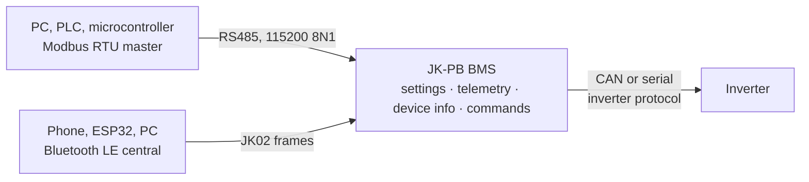
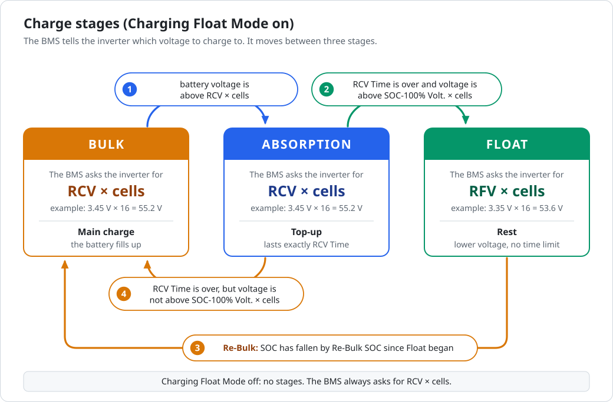

<h1 align="center">JK-BMS PB series protocol documentation</h1>

<p align="center">
  <b>Modbus RTU register map · RS485 · Bluetooth (JK02) · CAN and inverter protocols · charge stages and SOC</b>
</p>

<p align="center">
  <a href="LICENSE"></a>
  
  
</p>

<p align="center">
  <a href="#documents">Documents</a> ·
  <a href="#quick-start-read-the-pack-voltage-over-rs485">Quick start</a> ·
  <a href="#how-the-bms-charges">Charging and SOC</a> ·
  <a href="#before-you-write-anything">Safety</a> ·
  <a href="#frequently-asked-questions">FAQ</a> ·
  <a href="#українською">Українською</a>
</p>

Unofficial developer documentation for the communication protocols of **JK-BMS**
(Jikong, also written JK BMS or JKBMS) **PB-series** protection boards, the
"Inverter BMS" family. It was written for the **JK-PB2A16S20P** and checked on one.

It explains how to read cell voltages, current, temperatures, SOC and alarms from
the BMS, how to write settings, and how to send commands:

- over **RS485 with Modbus RTU**, with a complete register map;
- over **Bluetooth LE** with JK02 frames;
- to an inverter over **CAN** or a serial inverter protocol.

It also explains how the BMS behaves: protection, charge stages (Bulk, Absorption,
Float), the SOC counter, balancing, and the format of the firmware files.

## Documents

| Document | What it covers | Read it when |
|---|---|---|
| [Modbus RTU](docs/modbus-rtu.md) | Framing, addressing, data types, reads, writes, exceptions, timing, real frames | You connect a PC, a PLC or a microcontroller to the RS485 port |
| [Register map](docs/register-map.md) | Every address with its meaning, unit, accepted range, cross-field rules and example values | You need the address of a value or a setting |
| [Bluetooth (JK02)](docs/bluetooth-jk02.md) | GATT service, handshake, request and response frames, all command codes, write acknowledgement | You talk to the BMS from a phone, an ESP32 or a PC over Bluetooth LE |
| [Serial ports and CAN](docs/serial-ports-and-can.md) | Ports, protocol numbers, baud rates, CAN bit rates and frame IDs, pack address, parallel packs | You connect the BMS to an inverter or to other packs |
| [Device behaviour](docs/device-behaviour.md) | Protection logic, SOC estimation, what a write does, presets, balancing, heating, emergency start, sleep | You want to know what the BMS does with a setting |
| [How the BMS charges: stages and SOC](docs/charging-and-soc.md) ([українською](docs/charging-and-soc.uk.md)) | Bulk, Absorption, Float, Re-Bulk, and the rules that set SOC to 100 % and 0 %. Plain words and pictures first, exact logic after | The battery does not reach Float or 100 %, or you set RCV, RFV and Re-Bulk SOC |
| [Capability catalogue](docs/capabilities.md) | Every field the BMS exposes (settings, telemetry, device info, logs, event records) with units, ranges, scales and bit meanings, extracted from the vendor client model and cross-checked with the firmware | You need a field that the register map does not explain |
| [Firmware files and update](docs/firmware-update.md) | `.jkbms` and `.dsd` file format, raw image layout and expiry, compatibility rules, entering the bootloader, transfer checksum | You want to know what a firmware file contains |

## Interfaces



| Interface | Protocol | Document |
|---|---|---|
| RS485 | Modbus RTU slave, 115200 8N1 ✔ | [Modbus RTU](docs/modbus-rtu.md) |
| Bluetooth LE | JK02 frames (`AA 55 90 EB` requests, `55 AA EB 90` responses) | [Bluetooth (JK02)](docs/bluetooth-jk02.md) |
| CAN, RS232/RS485 to an inverter | Selectable inverter protocols | [Serial ports and CAN](docs/serial-ports-and-can.md) |

All interfaces read and write the same data blocks:

| Block | Modbus addresses | JK02 frame type | Content |
|---|---|---|---|
| Settings | 0x1000–0x1123 | 0x01 | Protection thresholds, limits, switches (stored in EEPROM) |
| Telemetry | 0x1200–0x1323 | 0x02 | Cell voltages, current, temperatures, SOC, MOS state, alarms |
| Device info | 0x1400–0x1523 | 0x03 | Model, versions, counters, names, port protocols, dry contacts |
| Commands | 0x1600–0x1637 (write only) | command codes | Calibration, shutdown, presets, RTC, frame requests |

A field has the same offset in every block on every interface. Modbus sends it
big-endian; JK02 frames send it little-endian.

## Quick start: read the pack voltage over RS485

Set the serial port to 115200 baud, 8N1. The slave address is the pack address from
the DIP switches (1 on a single pack).

```
Request:   01 03 12 90 00 02 C1 5E
Response:  01 03 04 00 00 D0 20 A6 2B
```

| Request bytes | Meaning |
|---|---|
| `01` | Slave address (pack address) |
| `03` | Function: read |
| `12 90` | Start address 0x1290 (pack voltage) |
| `00 02` | Two 16-bit registers |
| `C1 5E` | CRC-16 (Modbus), low byte first |

| Response bytes | Meaning |
|---|---|
| `01 03` | Slave address and function |
| `04` | Four data bytes follow |
| `00 00 D0 20` | 0x0000D020 = 53 280 mV = 53.28 V |
| `A6 2B` | CRC-16 |

Three rules that differ from most Modbus devices:

- Addresses are byte offsets: one 16-bit register moves the address by 2.
- The function codes are 0x03 (read) and 0x10 (write). The BMS has no others.
- Address 0 (broadcast) gets no answer.

Values to read first, all in the telemetry block ✔:

| Address | Type | Value |
|---|---|---|
| 0x1200 + 2·n | u16, mV | Voltage of cell *n* |
| 0x1290 | u32, mV | Pack voltage |
| 0x1298 | s32, mA | Pack current, + charge, − discharge |
| 0x12A6 | two bytes | Low byte: SOC in percent |
| 0x12A0 | u32, bitmask | Alarms |
| 0x1312 | two bytes | High byte: charge stage (0 Bulk, 1 Absorption, 2 Float) |

The [Modbus RTU](docs/modbus-rtu.md) page has the read and write rules, and the
[register map](docs/register-map.md) has every address.

## How the BMS charges

<p align="center">
  <a href="docs/charging-and-soc.md">
    
  </a>
</p>

With Charging Float Mode on, a JK-PB BMS goes through three stages:

- **Bulk** lasts until the pack voltage gets above RCV × cells.
- **Absorption** lasts the RCV Time. At its end the BMS goes to Float if the pack is
  above SOC-100% Volt. × cells, and back to Bulk if it is not.
- **Float** has no time limit. It ends when SOC has fallen by Re-Bulk SOC.

The BMS requests RCV × cells in Bulk and Absorption and RFV × cells in Float. The
stage changes were seen on the test battery ✔. The voltage that the inverter
receives was not checked ○.

SOC becomes 100 % by a voltage rule, and the rule depends on the pack address.
[How the BMS charges: stages and SOC](docs/charging-and-soc.md)
([українською](docs/charging-and-soc.uk.md)) explains this in plain words with
pictures, lists the settings, and answers the common questions: why the battery
does not reach Float, why SOC stays at 99 %, what RCV, RFV and Re-Bulk SOC do.

## Before you write anything

> [!WARNING]
> This device protects a large battery. A wrong write can weaken the protection
> or switch the battery off.

- Every accepted write is saved to EEPROM at once. Do not write on a timer or on
  every start-up.
- **Writing the battery capacity (0x107C) or loading a chemistry preset resets SOC**
  to a rough estimate from the cell voltage, even when you write the same value. ✔
  (capacity write)
- Some commands cannot be undone: shutdown, factory reset, calibration. See the
  [register map](docs/register-map.md#5-commands-0x1600-write-only).
- There is no authentication. Any device on the bus or any Bluetooth central can
  read the passcodes and change the protection settings.

## What was checked

The documents apply to firmware V19.x. Each statement carries a mark:

| Mark | Meaning |
|---|---|
| ✔ | Checked on a JK-PB2A16S20P (hardware 19A, firmware V19.30) |
| ○ | Expected, not yet checked on a device |
| ? | Assumed meaning, not confirmed |

No other model and no other firmware version was checked. If you have one, your
reads are welcome (see [Contributing](#contributing)).

## Frequently asked questions

### What are the RS485 settings of a JK-PB BMS?

Modbus RTU, 115200 baud, 8N1 ✔. The slave address is the pack address from the DIP
switches. See [Modbus RTU](docs/modbus-rtu.md#1-transport).

### Where is the Modbus register map of the JK BMS?

In the [register map](docs/register-map.md): settings from 0x1000, telemetry from
0x1200, device info from 0x1400 and commands from 0x1600. The
[capability catalogue](docs/capabilities.md) lists every field with its unit, scale
and bit meanings.

### How do I read SOC, cell voltages and current from a JK BMS?

Read the telemetry block. The [quick start](#quick-start-read-the-pack-voltage-over-rs485)
has the main addresses, and section 3 of the
[register map](docs/register-map.md#3-telemetry-block-0x12000x1323-read-only) has all
of them. Over Bluetooth the same values arrive in frame type 0x02.

### Which Bluetooth protocol does the JK-PB BMS use?

Bluetooth LE with JK02 frames on service 0xFFE0, characteristic 0xFFE1. It needs no
pairing and no PIN ✔. See [Bluetooth (JK02)](docs/bluetooth-jk02.md).

### Which inverter protocols can the BMS use over RS485 and CAN?

The BMS has a list of built-in serial protocols, selected by number: JK Modbus,
PYLON low voltage, Growatt, Voltronic, PACE, WOW and others, and a list of CAN
protocols with their bit rates and frame identifiers. Most of these were not checked
on a device ○. See
[Serial ports and CAN](docs/serial-ports-and-can.md#2-serial-protocol-list).

### Why does my JK BMS not reach Float, or not show 100 % SOC?

The usual reasons are the charge voltage that the BMS measures, the SOC-100% Volt.
setting, and the pack address. Section 1.5 of
[How the BMS charges](docs/charging-and-soc.md#15-common-questions) goes through them.

### Why did SOC change after I wrote the battery capacity?

A write of the nominal capacity replaces the SOC counter with an estimate from the
cell voltage ✔. See
[Device behaviour](docs/device-behaviour.md#22-soc-re-estimate).

### What is inside a `.jkbms` firmware file, and can I flash it myself?

[Firmware files and update](docs/firmware-update.md) describes the file format and
what the vendor updater sends. Nothing on that page was verified by flashing a
device. Use the vendor tool: a bad or interrupted flash bricks a BMS that manages a
live battery.

### Is the BMS protected by a password?

No. The passcodes are stored in the BMS and any device on the RS485 bus or any
Bluetooth central can read them and change the settings. Treat physical and radio
access to the BMS as full access.

## Українською

Це неофіційна документація для розробників про протоколи JK-BMS серії PB
(перевірено на JK-PB2A16S20P): Modbus RTU по RS485, Bluetooth із кадрами JK02, CAN
і протоколи інверторів, карта регістрів. Документи написані англійською.

Українською є сторінка про заряд:
[Як JK-PB BMS заряджає батарею: стадії і SOC](docs/charging-and-soc.uk.md). Вона
пояснює Bulk, Absorption, Float і Re-Bulk, налаштування RCV і RFV, і правила, за
якими SOC стає 100 % і 0 %.

## Contributing

Corrections and reads from other models or firmware versions are welcome. Open an
issue with the model, the hardware and firmware versions, and the raw frames you
saw. Remove serial numbers, Bluetooth names and passcodes from anything you post.

## Disclaimer and license

This project is not affiliated with Jikong (JK-BMS). Use it at your own risk.

[MIT](LICENSE)
