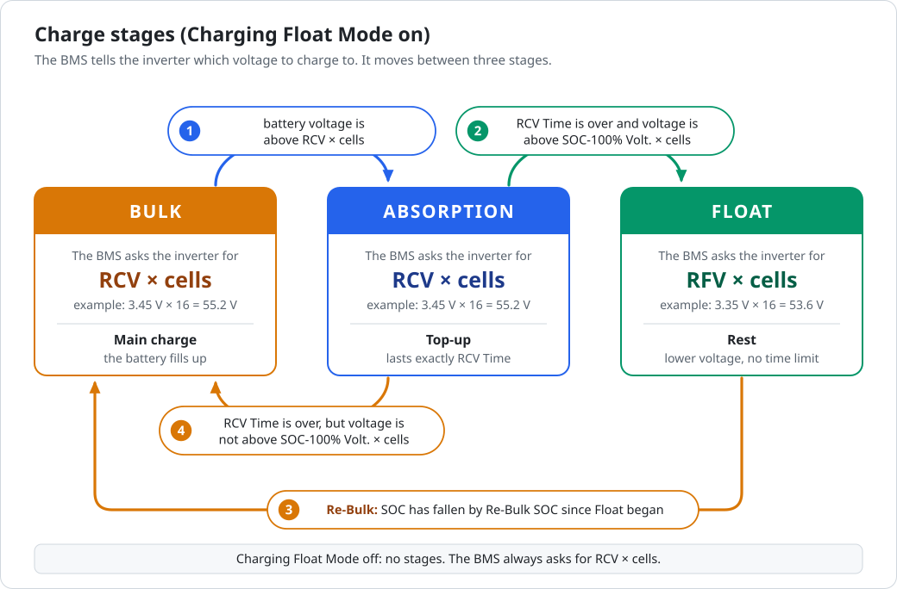
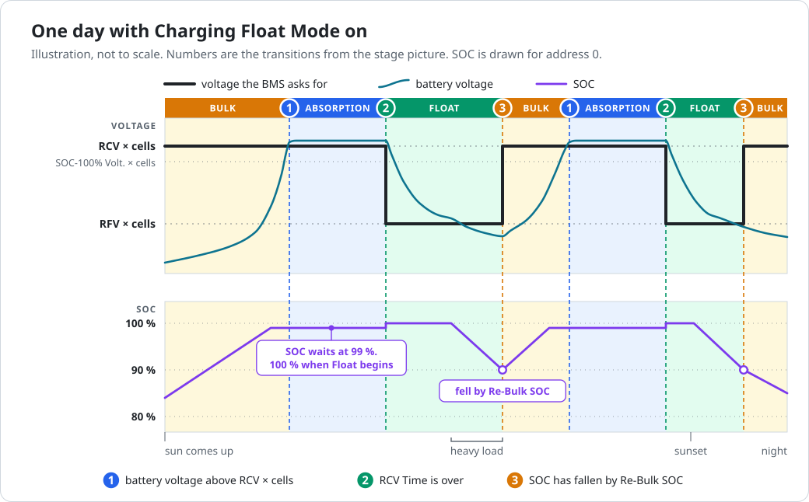
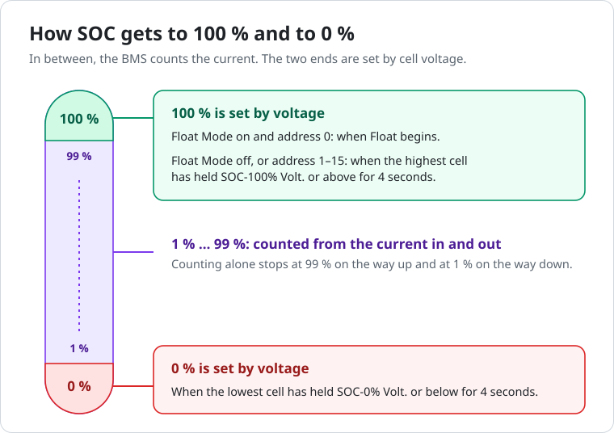

# How a JK-PB BMS charges: stages and SOC

[Українською](charging-and-soc.uk.md)

A JK-PB BMS with firmware **V19.10 or later** decides which voltage the inverter
must charge to (Bulk, Absorption, Float, Re-Bulk) and when the battery counts as
100 % or 0 % full. This page explains that logic.

- **[Part 1](#part-1-in-plain-words)** is for battery owners. It has no register
  numbers: only what happens, and which settings matter.
- **[Part 2](#part-2-technical-details)** is for developers: the exact conditions,
  the registers, and what was checked on a real battery.

Most of this logic comes from the firmware. Only a part of it was also seen on a real
battery; [section 2.1](#21-sources-and-marks) says which part.

> This page explains how the firmware behaves. It does not tell you which voltages
> are right for your cells. Take those from the maker of your cells.

---

## Part 1. In plain words

Words used here: a **cell** is one of the cells connected in series (16 in a
"48 V" LiFePO4 battery). "**× cells**" means "multiplied by the number of cells":
3.45 V × 16 = 55.2 V. **SOC** is the charge level in percent.

### 1.1 Three stages

The BMS does not charge the battery itself. It sends the inverter one number: the
voltage to charge to. For this the inverter must be connected to the BMS with a
data cable (CAN or RS485) and must be set to take its charge voltage from the BMS.
If the inverter uses its own voltage settings, the stages still change inside the
BMS, but the inverter does not follow them.

When the switch **Charging Float Mode** is on, the BMS moves between three stages:



The same in words:

- **Bulk**, the main charge. The BMS asks for RCV × cells. When the battery voltage
  climbs above that value, Absorption starts (①).
- **Absorption**, the top-up. The BMS asks for the same voltage for exactly
  **RCV Time**. It does not look at the battery voltage during this time. When the
  time is over, it makes one check:
  - ② the battery voltage is above SOC-100% Volt. × cells: Float starts;
  - ④ it is not, for example because a big load pulls the battery down: the BMS
    starts again from Bulk.
- **Float**, the rest. The BMS asks for a lower voltage, RFV × cells. Float has no
  time limit. It ends when SOC has fallen by **Re-Bulk SOC** percent since Float
  began (③, this is the Re-Bulk). Example: Float began at 100 % and Re-Bulk SOC
  is 10. At 90 % the BMS goes back to Bulk and asks for the full charge voltage again.

When Charging Float Mode is **off**, there are no stages. The BMS always asks for
RCV × cells.

### 1.2 One day as a picture



Read it from left to right:

- **Morning, Bulk.** The BMS asks for the RCV voltage. The battery fills up and its
  voltage rises.
- **① Absorption.** The battery voltage has passed RCV × cells. The BMS keeps asking
  for the same voltage until RCV Time is over.
- **② Float.** The BMS now asks for the lower RFV voltage. The inverter stops
  pushing current into a full battery and only holds it at that lower voltage. In
  this picture SOC also jumps from 99 % to 100 % here; section 1.4 explains when it
  does so earlier.
- **Heavy load, then ③ Re-Bulk.** The load takes more than the sun gives, and SOC
  falls. When it has fallen by Re-Bulk SOC, the BMS asks for the RCV voltage again.
  The battery is charged back up while there is still sun.
- **Evening.** After sunset SOC falls again. The BMS goes back to Bulk, so it asks
  for the full charge voltage as soon as the sun returns.

Older firmware left Float after a fixed time, RFV Time. A timer does not notice
that the battery was drained in the middle of the day. Re-Bulk SOC does. V19.10
removed the timer and added Re-Bulk SOC.

### 1.3 The settings that matter

The names are the ones the vendor software shows.

| Setting | What it does | Test battery |
|---|---|---|
| Charging Float Mode | Turns the three stages on. Off: the BMS always asks for RCV. | on |
| Vol. Cell RCV | Charge voltage per cell for Bulk and Absorption. | 3.45 V |
| Vol. Cell RFV | Charge voltage per cell for Float. | 3.35 V |
| RCV Time | How long Absorption lasts. | 0.5 h |
| SOC-100% Volt. | Two jobs. The battery must still be above this (× cells) at the end of Absorption to enter Float. And SOC becomes 100 % when the highest cell reaches it. The BMS accepts only a value below RCV. | 3.445 V |
| Re-Bulk SOC | How many percent SOC may fall during Float before the BMS returns to Bulk. From 1 to 50. | 1 % |
| SOC-0% Volt. | SOC becomes 0 % when the lowest cell falls to this voltage. | 2.90 V |
| RFV Time | Not used since V19.10. | — |

The last column is one 16-cell LiFePO4 battery. It is an example, not advice.

### 1.4 How SOC gets to 100 % and to 0 %



Between 1 % and 99 % the BMS **counts** the current that goes in and out. Counting
alone never shows 100 %: SOC stops at 99 % and waits for a sign from the voltage
that the battery is really full. Which sign it waits for depends on the address of
the BMS:

| Your BMS | When SOC becomes 100 % |
|---|---|
| Charging Float Mode **on** and address **0** | When Float begins. SOC shows 99 % during the whole Absorption. The picture in 1.2 shows this case. |
| Charging Float Mode **off**, or address **1–15** | When the highest cell has stayed at SOC-100% Volt. or above for 4 seconds. With usual settings this is about the moment Absorption starts, or a little earlier. |

On the way down SOC stops at 1 %. It becomes **0 %** when the lowest cell has stayed
at SOC-0% Volt. or below for 4 seconds. This rule is the same for every address.

This is why SOC can sit at 99 % for a while and then jump to 100 %. The jump also
removes the small errors that counting collects over many days.

**Which address does my BMS have?** The address is set with the four small DIP
switches on the BMS. All switches off is address 0. In a set of parallel batteries
address 0 is the host (master) and addresses 1–15 are the slaves; this comes from
summaries of the vendor manual. Owners report that the host is the BMS connected to
the inverter, and that a single battery is normally left at address 0. The vendor
software shows the address as Device Addr., and it is the two digits at the end of
the Bluetooth name (`-00`, `-01`, …). The test battery on this page has address 1,
so the address 0 case was not checked on it.

### 1.5 Common questions

**The battery never reaches Float.** Check in this order:

1. Charging Float Mode is on.
2. The battery voltage, as the BMS shows it, really gets above RCV × cells. If the
   inverter stops at that voltage or a little below it, Absorption never starts.
   Compare the voltage in the app with a good meter. If they differ, calibrate the
   BMS voltage in the app. One owner reported that Absorption started only after
   this calibration.
3. At the end of RCV Time the battery is still above SOC-100% Volt. × cells. If a
   load pulls the voltage down at that moment, the BMS returns to Bulk and starts
   again.

**Float is on, but nothing changes.** Either RFV is equal to RCV, so in Float the
BMS asks for the same voltage as before. Or the inverter does not take its charge
voltage from the BMS.

**Float ends almost at once.** Re-Bulk SOC is 1. The BMS returns to Bulk as soon
as SOC shows 99 %, which is about half a percent of the capacity. This was seen on
the test battery. Set a larger value if Float must survive small loads.

**SOC stays at 99 %.** SOC waits there for the sign described in 1.4. The usual
reasons:

1. Charging Float Mode is on and the address is 0. SOC becomes 100 % only when Float
   begins. If the battery does not reach Float (see the first question), SOC does
   not reach 100 %.
2. In the other cases the highest cell must hold SOC-100% Volt. for 4 seconds. If it
   never does, the charge voltage is too low for the cells, or SOC-100% Volt. is set
   too high.
3. The battery was at 100 %, lost about 1 %, and was charged again. The BMS does not
   count charge above 99 %, and the 100 % rule works again only after SOC has fallen
   to 98 % or lower. Until then SOC shows 99 %. This does no harm.

**Does one weak cell restart the RCV timer?** No. The stages look only at the
voltage of the whole battery, which is the sum of all cells. So in effect they look
at the average cell. And nothing restarts the RCV timer: once Absorption has
started, it runs to the end of RCV Time.

**Does the BMS look at single cells at all?** For the stages, no. For SOC, yes:
the highest cell for 100 % and the lowest cell for 0 %. Protection also looks at
single cells, but that is a different subject.

**Where can I see the stage?** The vendor PC software shows it as Charge Status
(Bulk, Abs or Float) with a timer. Developers can read it from the BMS, see
[2.5](#25-how-to-read-the-stage).

---

## Part 2. Technical details

### 2.1 Sources and marks

- The logic was read from firmware V19.34 (JK-PB2A16S20P). ○ = known from the
  firmware only.
- ✔ = also seen on a device (JK-PB2A16S20P, hardware 19A, firmware V19.30) by
  reading registers over RS485. Nothing was written for these checks.
- Vendor release note for V19.10: "Increase the Re-Bulk SOC parameter, optimize
  the float charging logic, and remove the RFV timer."

What was checked:

| Statement | |
|---|---|
| 0x1312 shows the stage (0, 1 and 2 seen) and 0x1310 the seconds in it (0 in Bulk) | ✔ |
| Absorption lasts RCV Time; the pack voltage is not checked during it | ✔ |
| Absorption → Float when the pack is above SOC-100% Volt. × cells at the end | ✔ (seen once) |
| Float is not left by time (77 min seen) or by voltage (pack below SOC-100% Volt. × cells, above RCV × cells and down near RFV × cells seen) | ✔ |
| Float → Bulk when SOC has fallen by Re-Bulk SOC since Float began | ✔ (seen once: Re-Bulk SOC 1, SOC 100 % → 99 %) |
| The pack voltage 0x1290 is the sum of the cell voltages | ✔ (within 1 mV) |
| SOC is rounded to the nearest percent | ✔ (99 548 of 100 000 mAh shows 100 %, 99 497 shows 99 %) |
| Bulk → Absorption, Absorption → Bulk | ○ |
| The voltage that goes to the inverter in each stage | ○ |
| SOC to 100 % and to 0 %, and the limits of counting | ○ |
| Address 0 with Charging Float Mode on: SOC 100 % only when Float begins | ○ (the test device has address 1; one owner with Charging Float Mode on reported no jump to 100 % before Absorption) |

### 2.2 Registers

Settings (the [register map](register-map.md) has the ranges and write rules):

| Register | Name in the vendor software | Use in this logic |
|---|---|---|
| 0x1114 bit 9 | Charging Float Mode | Enables the stage logic |
| 0x1020, u32, mV | Vol. Cell RCV | Request in Bulk and Absorption; threshold for Absorption |
| 0x1024, u32, mV | Vol. Cell RFV | Request in Float |
| 0x1018, u32, mV | SOC-100% Volt. | Gate for Float (× cells, against the pack); SOC 100 % (against the highest cell). Must be below 0x1020 ○ |
| 0x101C, u32, mV | SOC-0% Volt. | SOC 0 % (against the lowest cell) |
| 0x106C, u32 | Cell Count | Multiplier |
| 0x1504, high byte | RCV Time, × 0.1 h, 1–250 | Length of Absorption |
| 0x1504, low byte | RFV Time | Not used since V19.10; not writable on V19.30 ✔ |
| 0x1510, high byte | Re-Bulk SOC, %, 1–50 | SOC drop that ends Float. A stored value outside 1–50 becomes 1 at start-up ○ |
| 0x1108, u32 | Pack address | Selects the SOC 100 % rule, see [2.4](#24-soc-logic) |

Live values (telemetry block):

| Register | Meaning |
|---|---|
| 0x1312, high byte | Charge stage: 0 = Bulk, 1 = Absorption, 2 = Float (vendor name: Charge Status) |
| 0x1310, u16, s | Time in the current stage, at most 65530. 0 in Bulk (vendor name: Charge Status Time) |
| 0x1290, u32, mV | Pack voltage = the sum of the cell voltages |
| 0x1200 + 2·n, u16, mV | Voltage of cell n |
| 0x1248 | High byte: index of the highest cell. Low byte: index of the lowest cell |
| 0x12A7, u8, % | SOC |
| 0x12A8 / 0x12AC, mAh | Remaining capacity / full-charge capacity |
| 0x12F0, u32, 0.1 s | System tick counter, the time base of this logic |

### 2.3 Stage logic

| Stage | 0x1312 | Request | Leaves when | Next stage |
|---|---|---|---|---|
| Bulk | 0 | RCV × cells | pack > RCV × cells | Absorption |
| Absorption | 1 | RCV × cells | time in stage > RCV Time × 360 s | Float if pack > SOC-100% Volt. × cells, else Bulk |
| Float | 2 | RFV × cells | SOC at entry − SOC ≥ Re-Bulk SOC | Bulk |

The same as pseudo-code. It runs on every pass of the main loop. `pack` is 0x1290,
`SOC` is 0x12A7, and all voltages are in mV:

```
if not float_mode:                       # Charging Float Mode is off
    stage = BULK
    request = RCV * cells
    return

if stage == BULK and pack > RCV * cells:
    stage = ABSORPTION;  t0 = now

if stage == ABSORPTION and seconds(now - t0) > RCV_time * 360:
    stage = FLOAT if pack > SOC100_V * cells else BULK
    t0 = now

if stage == FLOAT:
    if seconds(now - t0) < 3:
        soc_ref = SOC
    elif soc_ref - SOC >= rebulk_soc:
        stage = BULK;  t0 = now

time_in_stage = 0 if stage == BULK else min(seconds(now - t0), 65530)
request = RFV * cells if stage == FLOAT else RCV * cells
```

Notes:

- All comparisons with the pack voltage are strict (`>`). A pack that sits exactly
  on RCV × cells does not start Absorption. ○
- The logic uses only the pack voltage, never a single cell. The pack voltage is
  the sum of the cell readings ✔, so the test is the same as "average cell > RCV".
  The voltage calibration factor (0x12DC, command 0x1600) scales every cell
  reading ○, so a wrong calibration moves both thresholds.
- The RCV timer is never restarted or paused. During Absorption the pack may fall
  below RCV × cells and even below SOC-100% Volt. × cells: only the value at the
  end counts. ✔
- `soc_ref` is taken during the first 3 s of Float and is not updated later. ○
- In Float the pack voltage has no effect. ✔ Float ends by the SOC drop ✔, or when
  Charging Float Mode is turned off ○.
- With Charging Float Mode off, 0x1312 is 0 and 0x1310 is not updated. ○
- `request` goes into the summary that the inverter protocols read. The protocol
  encoders that were examined send it as the charge voltage limit in units of 0.1 V
  (request / 100), with no offset. ○
- With parallel packs, the request comes from the stage logic of the BMS that builds
  this summary: its own pack voltage and its own SOC. The stages of the other packs
  are not used for it. ○

### 2.4 SOC logic

It runs on every pass, with Charging Float Mode on or off:

```
# 1. "full" and "empty" flags
if not full:
    if not float_mode or pack_address != 0:
        if highest_cell < SOC100_V:      t_full = now
        if seconds(now - t_full) >= 4:   full = True
    elif just_entered_float and highest_cell > SOC100_V:
        full = True                      # pack address 0 with float mode on
elif highest_cell < 0.90 * SOC100_V or SOC < 99:
    full = False

if not empty:
    if lowest_cell > SOC0_V:             t_empty = now
    if seconds(now - t_empty) >= 4:      empty = True
elif lowest_cell > 1.05 * SOC0_V:
    empty = False

# 2. coulomb counting (delta = current * time, positive when charging)
skip = (remaining > 0.99 * full_capacity and delta > 0) or \
       (remaining < 0.01 * full_capacity and delta < 0)
if not skip:
    remaining += delta
remaining = clamp(remaining, 0, full_capacity)

# 3. resets, once each time a flag becomes true
if rising_edge(empty):  remaining = 0
if rising_edge(full):   remaining = full_capacity

SOC = min(100, round(remaining * 100 / full_capacity))
```

Notes:

- `highest_cell` and `lowest_cell` are the cells that 0x1248 points to.
  `just_entered_float` is true in the pass after the stage changed from Absorption
  to Float.
- Counting alone keeps the remaining capacity between 1 % and 99 % of the full
  capacity. SOC 100 % and SOC 0 % come only from the two flags. ○
- After a reset to 100 %, the rule can fire again only after SOC has fallen below
  99 %, or the highest cell has fallen below 90 % of SOC-100% Volt. After a reset
  to 0 %, only after the lowest cell has risen above 105 % of SOC-0% Volt. ○
- A pack with address 0 and Charging Float Mode on does not use the 4 s rule. Its
  SOC becomes 100 % at the change from Absorption to Float. If the check at the end
  of RCV Time fails and the stage returns to Bulk, SOC stays at 99 % until a later
  pass reaches Float. ○
- After a reset to 100 %, a discharge that leaves SOC at 99 % does not arm the rule
  again, and charge is not counted above 99 %. SOC then stays at 99 % through the
  next charge; it must fall to 98 % first. ○
- A write of the nominal capacity and some commands replace the counter with an
  estimate from the cell voltage. That is a different mechanism, see
  [Device behaviour](device-behaviour.md#22-soc-re-estimate).

### 2.5 How to read the stage

Modbus RTU, read 2 registers at 0x1310 (frames from the test device):

```
Request:   01 03 13 10 00 02 C1 4A
Response:  01 03 04 0A 4D 02 00 68 9C
```

| Bytes of the response | Register | Meaning |
|---|---|---|
| `0A 4D` | 0x1310 | 2637 s in the current stage |
| `02 00` | 0x1312 | High byte 2: Float |

Bluetooth (JK02): the same fields are in the telemetry frame 0x02, at bytes 278–279
(time, little-endian) and 280 (stage). ○

### 2.6 Seen on the device

JK-PB2A16S20P, firmware V19.30, 16 cells, RCV 3450 mV (× 16 = 55.20 V), SOC-100%
Volt. 3445 mV (× 16 = 55.12 V), RCV Time 0.5 h, SOC 100 %:

| Time | Stage 0x1312 | 0x1310 | Pack 0x1290 | Current | What it shows |
|---|---|---|---|---|---|
| 11:14:45 | 1 Absorption | 828 s | 55.106 V | 0 A | |
| 11:17:17 | 1 Absorption | 979 s | 55.080 V | 0 A | Below both thresholds: the stage does not change |
| 11:30:54 | 1 Absorption | 1796 s | 55.237 V | 0 A | 4 s before the end of RCV Time (1800 s) |
| 11:31:09 | 2 Float | 10 s | 55.233 V | 0 A | Pack above 55.12 V → Float |
| 12:02:44 | 2 Float | 1905 s | 55.016 V | −0.6 A | Below SOC-100% Volt. × 16: still Float |
| 12:17:49 | 2 Float | 2810 s | 55.233 V | 0 A | Above RCV × 16: still Float |
| 12:32:54 | 2 Float | 3715 s | 55.190 V | −0.4 A | Still Float after 62 min |
| 12:47:58 | 2 Float | 4620 s | 53.676 V | +0.6 A | SOC 100 % (remaining 99 548 mAh) |
| 12:53:30 | 0 Bulk | 0 s | 53.677 V | +0.7 A | SOC 99 % (99 497 mAh): Re-Bulk, with Re-Bulk SOC = 1 |

### 2.7 Not checked yet

- The start of Absorption and the return from Absorption to Bulk.
- The voltage that the inverter really receives in each stage.
- The SOC rules of section 2.4 on a device, for address 0 and for the other
  addresses.
- The stage after a restart of the BMS.
- Packs in parallel: how the master combines the requests of the packs.
