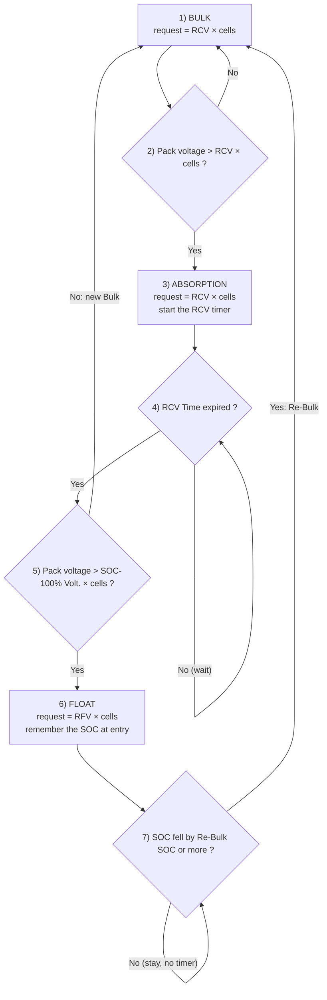
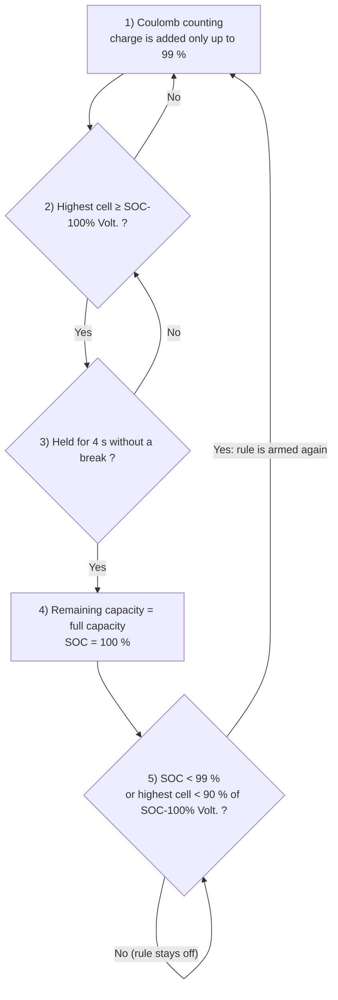
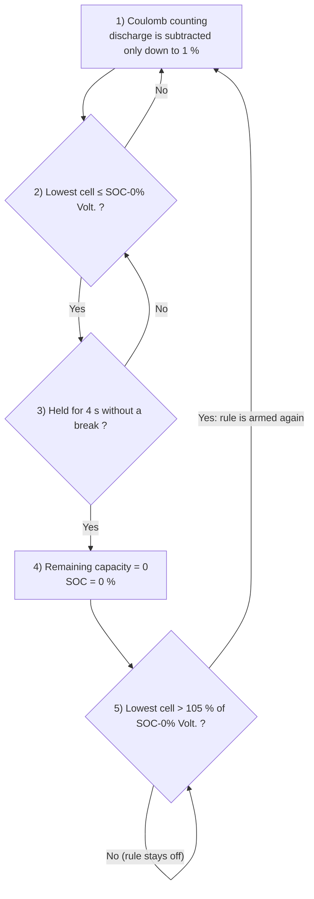

# Charge stages and SOC reset logic

[Українською](charging-and-soc.uk.md)

How a JK-PB BMS with firmware V19.10 or later decides which charge voltage it asks
the inverter for (Bulk, Absorption, Float, Re-Bulk), and when it sets SOC to 100 %
or to 0 %.

Sources and marks:

- The logic was read from firmware V19.34 (JK-PB2A16S20P). ○ = known from the
  firmware only.
- ✔ = also seen on a device (JK-PB2A16S20P, hardware 19A, firmware V19.30) by
  reading registers over RS485. Nothing was written for these checks.
- The vendor release note for V19.10 says: "Increase the Re-Bulk SOC parameter,
  optimize the float charging logic, and remove the RFV timer."

Firmware before V19.10 left Float with an RFV timer. V19.10 replaced the timer with
Re-Bulk SOC. This page describes V19.10 and later only.

## 1. Settings and registers

| Name in the vendor app | Register | Meaning here | Test device |
|---|---|---|---|
| Charging Float Mode | 0x1114 bit 9 | Turns the stage logic on | on |
| Vol. Cell RCV | 0x1020 | Charge voltage per cell for Bulk and Absorption | 3.450 V |
| Vol. Cell RFV | 0x1024 | Charge voltage per cell for Float | 3.350 V |
| SOC-100% Volt. | 0x1018 | Gate for Float, and the cell voltage that sets SOC to 100 % | 3.445 V |
| SOC-0% Volt. | 0x101C | The cell voltage that sets SOC to 0 % | 2.900 V |
| Cell Count | 0x106C | Multiplier for the pack thresholds | 16 |
| RCV Time | 0x1504, high byte, × 0.1 h | Length of Absorption | 0.5 h |
| Re-Bulk SOC | 0x1510, high byte, % | SOC drop that ends Float. Accepted range 1–50; an invalid stored value becomes 1. ○ | 1 |
| RFV Time | 0x1504, low byte | **Not used** since V19.10. Not writable on V19.30 ✔ | — |

Live values:

| Register | Meaning | |
|---|---|---|
| 0x1312, high byte | Charge stage: 0 = Bulk ○, 1 = Absorption ✔, 2 = Float ✔ (vendor name: Charge Status) | ✔ |
| 0x1310, u16, s | Time in the current stage. 0 in Bulk, restarts at each stage change (vendor name: Charge Status Time) | ✔ |
| 0x1290, u32, mV | Pack voltage, as the BMS measures it | ✔ |
| 0x1248 | High byte: index of the highest cell. Low byte: index of the lowest cell | ✔ |
| 0x12A7, % | SOC = remaining / full, rounded to the nearest percent, at most 100 | ✔ |
| 0x12A8 / 0x12AC, mAh | Remaining capacity / full-charge capacity | ✔ |

"Request" below means the charge voltage that the BMS sends to the inverter in the
inverter protocol (CAN or RS485). The BMS does not regulate the voltage itself. A
charger that does not listen to the BMS is not affected by the request, but the
stage logic still runs, because it only looks at the pack voltage and SOC.

## 2. Charge stages

With Charging Float Mode **off**, the stage is always Bulk and the request is always
RCV × cells. ○

With Charging Float Mode **on**:

| Step | What the firmware does | Example (test device, 16 cells) | |
|---|---|---|---|
| 1 | Bulk. Request = RCV × cells. The stage time 0x1310 is 0. | 3.450 × 16 = 55.20 V | ○ |
| 2 | Compares the pack voltage with RCV × cells. It must be **higher**, not equal. | > 55.20 V | ○ |
| 3 | Absorption starts. The request stays RCV × cells. | | ✔ (stage), ○ (request) |
| 4 | Waits for RCV Time. The voltage is **not** checked during this time: the pack may fall below RCV × cells and the stage does not change. | 0.5 h = 1800 s. The pack fell to 55.08 V and the stage stayed Absorption. | ✔ |
| 5 | When RCV Time ends, compares the pack voltage with SOC-100% Volt. × cells. Higher → Float. Not higher → back to Bulk (a load pulled the battery down; charge again). | 3.445 × 16 = 55.12 V. The pack was 55.24 V → Float. | ✔ (Float branch), ○ (Bulk branch) |
| 6 | Float. Request = RFV × cells. During the first 3 s the BMS stores the present SOC as the reference. | 3.350 × 16 = 53.60 V | ✔ (stage), ○ (request) |
| 7 | Stays in Float **without any time limit**. The pack voltage does not matter here. When (reference SOC − present SOC) ≥ Re-Bulk SOC, the stage returns to Bulk. | 30 min in Float, the pack fell to 55.08 V, the stage stayed Float. | ✔ (stays), ○ (Re-Bulk) |

Re-Bulk SOC is a **difference** from the SOC at the entry to Float. It is not an
absolute SOC level. Example: Float starts at 100 %, Re-Bulk SOC = 10 → the BMS asks
for RCV again when SOC reaches 90 %.

If Charging Float Mode is turned off, the stage returns to Bulk at once. ○

The stage logic never looks at single cells. It uses the pack voltage 0x1290, which
is the same as comparing the average cell with RCV. One low cell does not restart the
RCV timer; nothing restarts it. 0x1290 is the BMS's own measurement of the whole pack
with its calibration factor (0x12DC), so a wrong voltage calibration shifts both
thresholds (steps 2 and 5).

## 3. SOC to 100 %

The BMS counts charge in and out (coulomb counter). Counting alone does not bring
SOC to 100 %: while the remaining capacity is above 99 % of the full capacity,
charge is no longer added. ○ SOC reaches 100 % only through the rule below. This
also removes the error that the counter collected.

| Step | What the firmware does | Example (test device) | |
|---|---|---|---|
| 1 | Adds charge to the remaining capacity, but not above 99 % of the full capacity. Discharge is always counted here. | SOC stops at 99 % | ○ |
| 2–3 | The **highest** cell must be at or above SOC-100% Volt. for 4 s without a break. | ≥ 3.445 V | ○ |
| 4 | Sets the remaining capacity to the full capacity, once. | 100000 mAh, SOC 100 % | ○ |
| 5 | The rule can fire again only after SOC fell below 99 %, or the highest cell fell below 90 % of SOC-100% Volt. | < 99 %, or < 3.100 V | ○ |

This rule does not depend on the charge stage and works with Charging Float Mode on
or off. One exception: on a pack with **address 0** and Charging Float Mode on, the
4 s rule is not used. SOC is set to 100 % at the moment of the change from
Absorption to Float, if the highest cell is above SOC-100% Volt. at that moment. ○

## 4. SOC to 0 %

The same idea at the bottom. While the remaining capacity is below 1 % of the full
capacity, discharge is no longer subtracted. ○ SOC reaches 0 % only through this rule:

Example for the test device: the lowest cell at or below 2.900 V for 4 s → SOC 0 %.
The rule is armed again when the lowest cell is above 3.045 V. ○

## 5. What was seen on the device

JK-PB2A16S20P, firmware V19.30, 16 cells, current 0 A, SOC 100 %, read every 15 s:

| Time | 0x1312 stage | 0x1310 | Pack | Note |
|---|---|---|---|---|
| 11:14:45 | 1 Absorption | 828 s | 55.106 V | |
| 11:17:17 | 1 Absorption | 979 s | 55.080 V | Below RCV × 16 (55.20 V) and below SOC-100% × 16 (55.12 V): no stage change |
| 11:30:54 | 1 Absorption | 1796 s | 55.237 V | |
| 11:31:09 | 2 Float | 10 s | 55.233 V | RCV Time (1800 s) ended, pack above 55.12 V |
| 12:01:14 | 2 Float | 1815 s | 55.084 V | Still Float after 30 min; the voltage does not matter |

Not seen yet: the start of Absorption, the return from Absorption to Bulk, the
Re-Bulk from Float, and the SOC rules of sections 3 and 4.

## 6. Practical consequences

- **RFV = RCV.** The stage still changes to Float, but the request does not change.
  Float then has no effect, and Re-Bulk SOC has no effect.
- **Re-Bulk SOC = 1.** This is the value the firmware uses when the stored one is
  invalid, and the value on the test device. SOC is rounded, so a Float that started
  at 100 % ends after about 0.5 % of the capacity is discharged. Use a larger value
  if Float must survive small loads. ○
- **SOC-100% Volt. has two jobs.** It is the gate for Float (pack voltage at the end
  of RCV Time) and the trigger for SOC 100 % (highest cell). If it is set higher
  than the pack really holds at the end of Absorption, the BMS returns to Bulk every
  time and never reaches Float.
- **Absorption needs a pack voltage above RCV × cells**, measured by the BMS. If the
  charger holds the pack at or below that value, Absorption does not start, and
  Float never comes. ○ One user reported that Absorption started only after the
  voltage calibration of the BMS was corrected.
- **No Float without Charging Float Mode.** With the switch off, none of the stage
  logic runs. The SOC rules still work.
- **Monitoring.** 0x1312 and 0x1310 show the stage and the time in it. They are in
  the telemetry block, so they are also in the JK02 frame 0x02 (bytes 278–279 and
  280). ○
