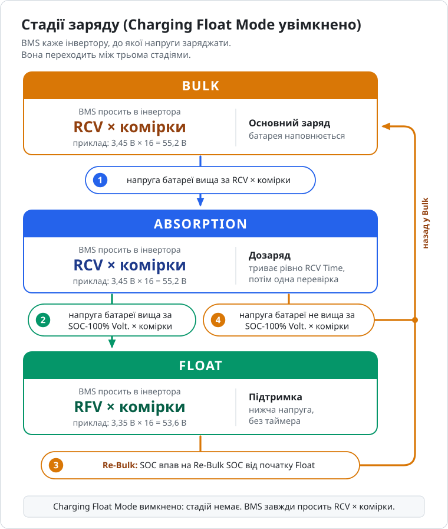
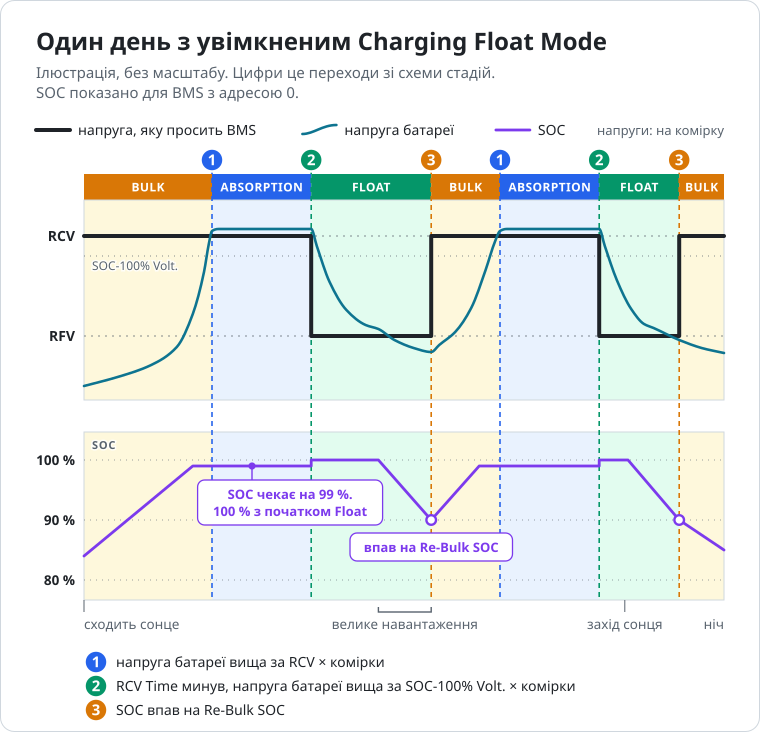
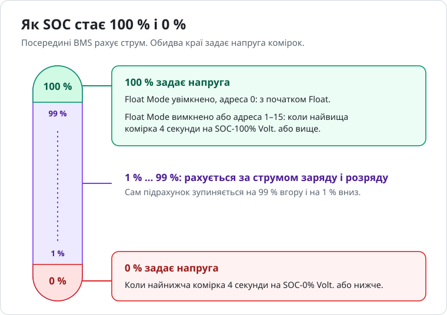

# Як JK-PB BMS заряджає батарею: стадії і SOC

[English](charging-and-soc.md)

JK-PB BMS з прошивкою **V19.10 або новішою** вирішує, до якої напруги інвертор має
заряджати батарею (Bulk, Absorption, Float, Re-Bulk), і коли батарея вважається
зарядженою на 100 % або на 0 %. Ця сторінка пояснює цю логіку.

- **[Частина 1](#частина-1-простими-словами)** для власників батарей. У ній немає
  номерів регістрів: тільки що відбувається і які налаштування важливі.
- **[Частина 2](#частина-2-технічні-деталі)** для розробників: точні умови, регістри
  і що перевірено на справжній батареї.

Більшість цієї логіки взято з прошивки. Тільки частину з неї бачили ще й на справжній
батареї; яку саме, сказано в [розділі 2.1](#21-джерела-і-позначки).

> Сторінка пояснює, як поводиться прошивка. Вона не каже, які напруги правильні для
> ваших комірок. Беріть їх у виробника комірок.

---

## Частина 1. Простими словами

Слова, які тут вживаються: **комірка** це одна з комірок, з'єднаних послідовно
(у батареї «на 48 В» з LiFePO4 їх 16). «**× комірки**» означає «помножити на
кількість комірок»: 3,45 В × 16 = 55,2 В. **SOC** це рівень заряду у відсотках.

### 1.1 Три стадії

BMS не заряджає батарею сама. Вона передає інвертору одне число: напругу, до якої
треба заряджати. Для цього інвертор має бути з'єднаний з BMS кабелем даних (CAN або
RS485) і налаштований брати напругу заряду від BMS. Якщо інвертор працює за власними
налаштуваннями напруги, стадії всередині BMS все одно змінюються, але інвертор на
них не зважає.

Коли перемикач **Charging Float Mode** увімкнено, BMS переходить між трьома
стадіями:



Те саме словами:

- **Bulk**, основний заряд. BMS просить RCV × комірки. Коли напруга батареї
  піднімається вище цього значення, починається Absorption (①).
- **Absorption**, дозаряд. BMS просить ту саму напругу рівно **RCV Time**. У цей час
  вона на напругу батареї не дивиться. Коли час минув, робить одну перевірку:
  - ② напруга батареї вища за SOC-100% Volt. × комірки: починається Float;
  - ④ не вища, наприклад через велике навантаження, яке просаджує батарею: BMS
    починає знову з Bulk.
- **Float**, підтримка. BMS просить нижчу напругу, RFV × комірки. Обмеження за часом
  немає. Float закінчується, коли SOC впав на **Re-Bulk SOC** відсотків від початку
  Float (③, це і є Re-Bulk). Приклад: Float почався на 100 %, Re-Bulk SOC дорівнює
  10. На 90 % BMS повертається в Bulk і знову просить повну напругу заряду.

Коли Charging Float Mode **вимкнено**, стадій немає. BMS завжди просить
RCV × комірки.

### 1.2 Один день на графіку



Читайте зліва направо:

- **Ранок, Bulk.** BMS просить напругу RCV. Батарея наповнюється, її напруга росте.
- **① Absorption.** Напруга батареї перейшла за RCV × комірки. BMS просить ту саму
  напругу, поки не мине RCV Time.
- **② Float.** Тепер BMS просить нижчу напругу RFV. Інвертор перестає штовхати струм
  у повну батарею і лише тримає її на цій нижчій напрузі. На цьому графіку SOC тут
  же стрибає з 99 % на 100 %; у розділі 1.4 пояснено, коли це стається раніше.
- **Велике навантаження, потім ③ Re-Bulk.** Навантаження забирає більше, ніж дає
  сонце, і SOC падає. Коли він впав на Re-Bulk SOC, BMS знову просить напругу RCV.
  Батарея заряджається назад, поки ще є сонце.
- **Вечір.** Після заходу сонця SOC знову падає. BMS повертається в Bulk, тому
  попросить повну напругу заряду, щойно сонце повернеться.

Старіші прошивки виходили з Float через фіксований час, RFV Time. Таймер не помічає,
що батарею розрядили посеред дня. Re-Bulk SOC помічає. У V19.10 таймер прибрали і
додали Re-Bulk SOC.

### 1.3 Налаштування, які важливі

Назви такі, як їх показує програма виробника.

| Налаштування | Що робить | Тестова батарея |
|---|---|---|
| Charging Float Mode | Вмикає три стадії. Вимкнено: BMS завжди просить RCV. | увімкнено |
| Vol. Cell RCV | Напруга заряду на комірку для Bulk і Absorption. | 3,45 В |
| Vol. Cell RFV | Напруга заряду на комірку для Float. | 3,35 В |
| RCV Time | Скільки триває Absorption. | 0,5 год |
| SOC-100% Volt. | Дві ролі. У кінці Absorption батарея має бути ще вище цього значення (× комірки), щоб перейти у Float. І SOC стає 100 %, коли найвища комірка до нього доходить. BMS приймає тільки значення, нижче за RCV. | 3,445 В |
| Re-Bulk SOC | На скільки відсотків SOC може впасти у Float, перш ніж BMS повернеться в Bulk. Від 1 до 50. | 1 % |
| SOC-0% Volt. | SOC стає 0 %, коли найнижча комірка падає до цієї напруги. | 2,90 В |
| RFV Time | Не використовується з V19.10. | — |

Остання колонка це одна батарея LiFePO4 з 16 комірок. Це приклад, а не порада.

### 1.4 Як SOC стає 100 % і 0 %



Між 1 % і 99 % BMS **рахує** струм, який заходить і виходить. Сам підрахунок ніколи
не покаже 100 %: SOC зупиняється на 99 % і чекає на знак від напруги, що батарея
справді повна. На який саме знак, залежить від адреси BMS:

| Ваша BMS | Коли SOC стає 100 % |
|---|---|
| Charging Float Mode **увімкнено** і адреса **0** | Коли починається Float. Увесь Absorption SOC показує 99 %. Саме цей випадок показано на графіку в 1.2. |
| Charging Float Mode **вимкнено** або адреса **1–15** | Коли найвища комірка протрималась на SOC-100% Volt. або вище 4 секунди. Зі звичними налаштуваннями це приблизно момент початку Absorption або трохи раніше. |

Вниз SOC зупиняється на 1 %. Він стає **0 %**, коли найнижча комірка протрималась на
SOC-0% Volt. або нижче 4 секунди. Це правило однакове для будь-якої адреси.

Тому SOC може якийсь час стояти на 99 %, а потім стрибнути на 100 %. Цей стрибок
заодно прибирає дрібні похибки, які підрахунок накопичує за багато днів.

**Яка адреса в моєї BMS?** Адресу задають чотири маленькі DIP-перемикачі на BMS. Усі
вимкнені означає адресу 0. У наборі паралельних батарей адреса 0 це головна (host,
master), а адреси 1–15 підлеглі (slave); так сказано в переказах інструкції
виробника. Власники повідомляють, що головна це та BMS, яка під'єднана до інвертора,
і що одну батарею зазвичай лишають на адресі 0. Програма виробника показує адресу як
Device Addr., і це ж дві цифри в кінці імені Bluetooth (`-00`, `-01`, …). Тестова
батарея на цій сторінці має адресу 1, тому випадок з адресою 0 на ній не перевіряли.

### 1.5 Часті питання

**Батарея ніколи не доходить до Float.** Перевірте по черзі:

1. Charging Float Mode увімкнено.
2. Напруга батареї, як її показує BMS, справді піднімається вище RCV × комірки.
   Якщо інвертор зупиняється на цій напрузі або трохи нижче, Absorption не
   почнеться. Порівняйте напругу в застосунку з добрим мультиметром. Якщо вони
   різняться, відкалібруйте напругу BMS у застосунку. Один власник повідомив, що в
   нього Absorption почався тільки після такого калібрування.
3. У кінці RCV Time батарея ще вища за SOC-100% Volt. × комірки. Якщо в цей момент
   навантаження просаджує напругу, BMS повертається в Bulk і починає знову.

**Float увімкнено, але нічого не змінюється.** Або RFV дорівнює RCV, і тоді у Float
BMS просить ту саму напругу, що й раніше. Або інвертор не бере напругу заряду від
BMS.

**Float закінчується майже одразу.** Re-Bulk SOC дорівнює 1. BMS повертається в
Bulk, щойно SOC покаже 99 %, а це приблизно пів відсотка ємності. Саме так було на
тестовій батареї. Поставте більше значення, якщо Float має переживати малі
навантаження.

**SOC стоїть на 99 %.** SOC чекає там на знак, описаний у 1.4. Звичні причини:

1. Charging Float Mode увімкнено, адреса 0. SOC стає 100 % тільки з початком Float.
   Якщо батарея не доходить до Float (див. перше питання), SOC не дійде до 100 %.
2. В інших випадках найвища комірка має протриматись на SOC-100% Volt. 4 секунди.
   Якщо цього не стається, напруга заряду для комірок замала або SOC-100% Volt.
   стоїть зависоко.
3. Батарея була на 100 %, втратила приблизно 1 % і зарядилась знову. BMS не рахує
   заряд вище 99 %, а правило на 100 % спрацює знову тільки після того, як SOC впаде
   до 98 % або нижче. До того SOC показує 99 %. Шкоди від цього немає.

**Чи скидає одна слабка комірка таймер RCV?** Ні. Стадії дивляться тільки на
напругу всієї батареї, а це сума всіх комірок. Тобто по суті на середню комірку.
І таймер RCV ніщо не скидає: якщо Absorption почався, він іде до кінця RCV Time.

**А BMS взагалі дивиться на окремі комірки?** Для стадій ні. Для SOC так: найвища
комірка для 100 % і найнижча для 0 %. Захист теж дивиться на окремі комірки, але це
інша тема.

**Де побачити стадію?** Програма виробника для ПК показує її як Charge Status
(Bulk, Abs або Float) разом із таймером. Розробники можуть прочитати її з BMS, див.
[2.5](#25-як-прочитати-стадію).

---

## Частина 2. Технічні деталі

### 2.1 Джерела і позначки

- Логіку прочитано з прошивки V19.34 (JK-PB2A16S20P). ○ = відомо тільки з прошивки.
- ✔ = це також бачили на пристрої (JK-PB2A16S20P, плата 19A, прошивка V19.30),
  читаючи регістри по RS485. Для цих перевірок нічого не записували.
- Примітка виробника до V19.10: "Increase the Re-Bulk SOC parameter, optimize the
  float charging logic, and remove the RFV timer."

Що перевірено:

| Твердження | |
|---|---|
| 0x1312 показує стадію (бачили 0, 1 і 2), а 0x1310 секунди в ній (у Bulk 0) | ✔ |
| Absorption триває RCV Time; напруга батареї в цей час не перевіряється | ✔ |
| Absorption → Float, коли в кінці батарея вища за SOC-100% Volt. × комірки | ✔ (бачили один раз) |
| Float не закінчується за часом (бачили 77 хв) і за напругою (бачили батарею нижче SOC-100% Volt. × комірки, вище RCV × комірки і внизу біля RFV × комірки) | ✔ |
| Float → Bulk, коли SOC впав на Re-Bulk SOC від початку Float | ✔ (бачили один раз: Re-Bulk SOC 1, SOC 100 % → 99 %) |
| Напруга батареї 0x1290 це сума напруг комірок | ✔ (з точністю 1 мВ) |
| SOC округлюється до найближчого відсотка | ✔ (99 548 з 100 000 мА·год показує 100 %, 99 497 показує 99 %) |
| Bulk → Absorption, Absorption → Bulk | ○ |
| Напруга, яка йде до інвертора в кожній стадії | ○ |
| SOC у 100 % і в 0 %, межі підрахунку | ○ |
| Адреса 0 з увімкненим Charging Float Mode: SOC 100 % тільки з початком Float | ○ (тестовий пристрій має адресу 1; один власник з увімкненим Charging Float Mode повідомив, що перед Absorption SOC на 100 % не стрибнув) |

### 2.2 Регістри

Налаштування (діапазони і правила запису є в [карті регістрів](register-map.md)):

| Регістр | Назва в програмі виробника | Роль у цій логіці |
|---|---|---|
| 0x1114, біт 9 | Charging Float Mode | Вмикає логіку стадій |
| 0x1020, u32, мВ | Vol. Cell RCV | Запит у Bulk і Absorption; поріг для Absorption |
| 0x1024, u32, мВ | Vol. Cell RFV | Запит у Float |
| 0x1018, u32, мВ | SOC-100% Volt. | Умова для Float (× комірки, проти напруги батареї); SOC 100 % (проти найвищої комірки). Має бути нижче 0x1020 ○ |
| 0x101C, u32, мВ | SOC-0% Volt. | SOC 0 % (проти найнижчої комірки) |
| 0x106C, u32 | Cell Count | Множник |
| 0x1504, старший байт | RCV Time, × 0,1 год, 1–250 | Тривалість Absorption |
| 0x1504, молодший байт | RFV Time | Не використовується з V19.10; на V19.30 не записується ✔ |
| 0x1510, старший байт | Re-Bulk SOC, %, 1–50 | Просадка SOC, яка завершує Float. Збережене значення поза 1–50 стає 1 при старті ○ |
| 0x1108, u32 | Адреса батареї | Вибирає правило для SOC 100 %, див. [2.4](#24-логіка-soc) |

Поточні значення (блок телеметрії):

| Регістр | Що означає |
|---|---|
| 0x1312, старший байт | Стадія заряду: 0 = Bulk, 1 = Absorption, 2 = Float (назва виробника: Charge Status) |
| 0x1310, u16, с | Час у поточній стадії, не більше 65530. У Bulk дорівнює 0 (назва виробника: Charge Status Time) |
| 0x1290, u32, мВ | Напруга батареї = сума напруг комірок |
| 0x1200 + 2·n, u16, мВ | Напруга комірки n |
| 0x1248 | Старший байт: номер найвищої комірки. Молодший байт: номер найнижчої комірки |
| 0x12A7, u8, % | SOC |
| 0x12A8 / 0x12AC, мА·год | Залишкова ємність / повна ємність |
| 0x12F0, u32, 0,1 с | Системний лічильник тіків, від нього рахується час у цій логіці |

### 2.3 Логіка стадій

| Стадія | 0x1312 | Запит | Коли закінчується | Наступна стадія |
|---|---|---|---|---|
| Bulk | 0 | RCV × комірки | батарея > RCV × комірки | Absorption |
| Absorption | 1 | RCV × комірки | час у стадії > RCV Time × 360 с | Float, якщо батарея > SOC-100% Volt. × комірки, інакше Bulk |
| Float | 2 | RFV × комірки | SOC на вході − SOC ≥ Re-Bulk SOC | Bulk |

Те саме псевдокодом. Він виконується на кожному проході головного циклу. `pack` це
0x1290, `SOC` це 0x12A7, усі напруги в мВ:

```
if not float_mode:                       # Charging Float Mode вимкнено
    stage = BULK
    request = RCV * cells
    return

if stage == BULK and pack > RCV * cells:
    stage = ABSORPTION;  t0 = now

if stage == ABSORPTION and seconds(now - t0) > RCV_time * 360:
    stage = FLOAT if pack > SOC100_V * cells else BULK
    t0 = now

if stage == FLOAT:
    if seconds(now - t0) < 3:
        soc_ref = SOC
    elif soc_ref - SOC >= rebulk_soc:
        stage = BULK;  t0 = now

time_in_stage = 0 if stage == BULK else min(seconds(now - t0), 65530)
request = RFV * cells if stage == FLOAT else RCV * cells
```

Примітки:

- Усі порівняння з напругою батареї строгі (`>`). Батарея, яка стоїть рівно на
  RCV × комірки, Absorption не запускає. ○
- Логіка бере тільки напругу батареї і ніколи окрему комірку. Напруга батареї це
  сума показів комірок ✔, тому перевірка рівнозначна «середня комірка > RCV».
  Коефіцієнт калібрування напруги (0x12DC, команда 0x1600) масштабує покази всіх
  комірок ○, тому неправильне калібрування зсуває обидва пороги.
- Таймер RCV ніколи не скидається і не зупиняється. Під час Absorption батарея може
  впасти нижче RCV × комірки і навіть нижче SOC-100% Volt. × комірки: важить тільки
  значення в кінці. ✔
- `soc_ref` береться в перші 3 с Float і далі не оновлюється. ○
- У Float напруга батареї ні на що не впливає. ✔ Float закінчується через просадку
  SOC ✔ або коли вимкнули Charging Float Mode ○.
- Якщо Charging Float Mode вимкнено, 0x1312 дорівнює 0, а 0x1310 не оновлюється. ○
- `request` потрапляє у зведення, яке читають протоколи інвертора. Ті кодувальники
  протоколів, які переглянуто, відправляють його як ліміт напруги заряду в одиницях
  0,1 В (request / 100), без зсуву. ○
- У паралельних батарей запит дає логіка стадій тієї BMS, яка будує це зведення: за
  своєю напругою і своїм SOC. Стадії інших батарей для нього не використовуються. ○

### 2.4 Логіка SOC

Виконується на кожному проході, з увімкненим або вимкненим Charging Float Mode:

```
# 1. прапорці "full" (повна) і "empty" (порожня)
if not full:
    if not float_mode or pack_address != 0:
        if highest_cell < SOC100_V:      t_full = now
        if seconds(now - t_full) >= 4:   full = True
    elif just_entered_float and highest_cell > SOC100_V:
        full = True                      # адреса 0 і float mode увімкнено
elif highest_cell < 0.90 * SOC100_V or SOC < 99:
    full = False

if not empty:
    if lowest_cell > SOC0_V:             t_empty = now
    if seconds(now - t_empty) >= 4:      empty = True
elif lowest_cell > 1.05 * SOC0_V:
    empty = False

# 2. підрахунок ємності (delta = струм * час, додатна при заряді)
skip = (remaining > 0.99 * full_capacity and delta > 0) or \
       (remaining < 0.01 * full_capacity and delta < 0)
if not skip:
    remaining += delta
remaining = clamp(remaining, 0, full_capacity)

# 3. скидання, один раз щоразу, коли прапорець стає True
if rising_edge(empty):  remaining = 0
if rising_edge(full):   remaining = full_capacity

SOC = min(100, round(remaining * 100 / full_capacity))
```

Примітки:

- `highest_cell` і `lowest_cell` це комірки, на які вказує 0x1248.
  `just_entered_float` істинне на проході після зміни стадії з Absorption на Float.
- Сам підрахунок тримає залишкову ємність між 1 % і 99 % повної. SOC 100 % і SOC 0 %
  з'являються тільки через два прапорці. ○
- Після скидання в 100 % правило може спрацювати знову тільки після того, як SOC
  впав нижче 99 % або найвища комірка впала нижче 90 % від SOC-100% Volt. Після
  скидання в 0 %: тільки після того, як найнижча комірка піднялась вище 105 % від
  SOC-0% Volt. ○
- Батарея з адресою 0 і увімкненим Charging Float Mode не використовує правило 4 с.
  Її SOC стає 100 % у момент переходу з Absorption у Float. Якщо перевірка в кінці
  RCV Time не пройшла і стадія повернулась у Bulk, SOC лишається 99 %, поки
  наступний прохід не дійде до Float. ○
- Після скидання в 100 % розряд, який лишає SOC на 99 %, правило знову не зводить, а
  заряд вище 99 % не рахується. Тоді SOC лишається 99 % і на наступному заряді;
  спершу він має впасти до 98 %. ○
- Запис номінальної ємності і деякі команди замінюють лічильник оцінкою за напругою
  комірок. Це інший механізм, див.
  [Device behaviour](device-behaviour.md#22-soc-re-estimate).

### 2.5 Як прочитати стадію

Modbus RTU, читання 2 регістрів з 0x1310 (кадри з тестового пристрою):

```
Request:   01 03 13 10 00 02 C1 4A
Response:  01 03 04 0A 4D 02 00 68 9C
```

| Байти відповіді | Регістр | Що означає |
|---|---|---|
| `0A 4D` | 0x1310 | 2637 с у поточній стадії |
| `02 00` | 0x1312 | Старший байт 2: Float |

Bluetooth (JK02): ті самі поля є в кадрі телеметрії 0x02, байти 278–279 (час,
little-endian) і 280 (стадія). ○

### 2.6 Що бачили на пристрої

JK-PB2A16S20P, прошивка V19.30, 16 комірок, RCV 3450 мВ (× 16 = 55,20 В), SOC-100%
Volt. 3445 мВ (× 16 = 55,12 В), RCV Time 0,5 год, SOC 100 %:

| Час | Стадія 0x1312 | 0x1310 | Батарея 0x1290 | Струм | Що це показує |
|---|---|---|---|---|---|
| 11:14:45 | 1 Absorption | 828 с | 55,106 В | 0 А | |
| 11:17:17 | 1 Absorption | 979 с | 55,080 В | 0 А | Нижче обох порогів: стадія не змінюється |
| 11:30:54 | 1 Absorption | 1796 с | 55,237 В | 0 А | За 4 с до кінця RCV Time (1800 с) |
| 11:31:09 | 2 Float | 10 с | 55,233 В | 0 А | Батарея вища за 55,12 В → Float |
| 12:02:44 | 2 Float | 1905 с | 55,016 В | −0,6 А | Нижче SOC-100% Volt. × 16: досі Float |
| 12:17:49 | 2 Float | 2810 с | 55,233 В | 0 А | Вище RCV × 16: досі Float |
| 12:32:54 | 2 Float | 3715 с | 55,190 В | −0,4 А | Через 62 хв досі Float |
| 12:47:58 | 2 Float | 4620 с | 53,676 В | +0,6 А | SOC 100 % (залишок 99 548 мА·год) |
| 12:53:30 | 0 Bulk | 0 с | 53,677 В | +0,7 А | SOC 99 % (99 497 мА·год): Re-Bulk при Re-Bulk SOC = 1 |

### 2.7 Що ще не перевірено

- Початок Absorption і повернення з Absorption у Bulk.
- Напруга, яку інвертор справді отримує в кожній стадії.
- Правила SOC з розділу 2.4 на пристрої, для адреси 0 і для інших адрес.
- Стадія після перезапуску BMS.
- Паралельні батареї: як головна об'єднує запити окремих батарей.
