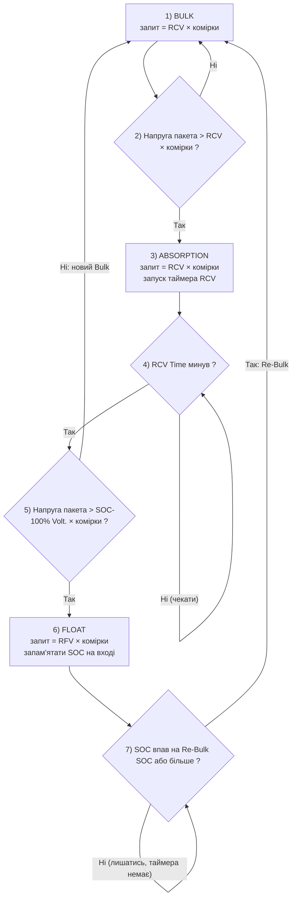
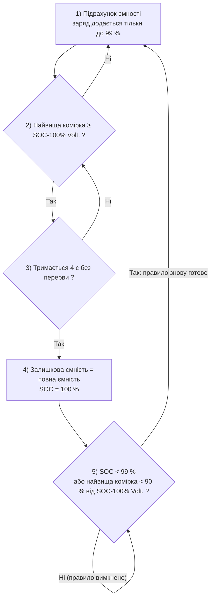
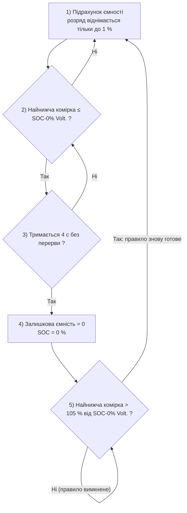

# Стадії заряду і логіка скидання SOC

[English](charging-and-soc.md)

Як JK-PB BMS з прошивкою V19.10 і новішою вирішує, яку напругу заряду просити в
інвертора (Bulk, Absorption, Float, Re-Bulk), і коли вона ставить SOC у 100 % або
в 0 %.

Джерела і позначки:

- Логіку прочитано з прошивки V19.34 (JK-PB2A16S20P). ○ = відомо тільки з прошивки.
- ✔ = це також бачили на пристрої (JK-PB2A16S20P, плата 19A, прошивка V19.30),
  читаючи регістри по RS485. Для цих перевірок нічого не записували.
- У примітках виробника до V19.10 написано: "Increase the Re-Bulk SOC parameter,
  optimize the float charging logic, and remove the RFV timer."

Прошивки до V19.10 виходили з Float за таймером RFV. У V19.10 таймер замінили на
Re-Bulk SOC. Ця сторінка описує тільки V19.10 і новіші.

## 1. Налаштування і регістри

| Назва в застосунку виробника | Регістр | Що це тут означає | Тестовий пристрій |
|---|---|---|---|
| Charging Float Mode | 0x1114, біт 9 | Вмикає логіку стадій | увімкнено |
| Vol. Cell RCV | 0x1020 | Напруга заряду на комірку для Bulk і Absorption | 3,450 В |
| Vol. Cell RFV | 0x1024 | Напруга заряду на комірку для Float | 3,350 В |
| SOC-100% Volt. | 0x1018 | Умова переходу у Float і напруга комірки, яка ставить SOC у 100 % | 3,445 В |
| SOC-0% Volt. | 0x101C | Напруга комірки, яка ставить SOC у 0 % | 2,900 В |
| Cell Count | 0x106C | Множник для порогів пакета | 16 |
| RCV Time | 0x1504, старший байт, × 0,1 год | Тривалість Absorption | 0,5 год |
| Re-Bulk SOC | 0x1510, старший байт, % | Просадка SOC, яка завершує Float. Допустимо 1–50; некоректне збережене значення стає 1. ○ | 1 |
| RFV Time | 0x1504, молодший байт | **Не використовується** з V19.10. На V19.30 не записується ✔ | — |

Поточні значення:

| Регістр | Що означає | |
|---|---|---|
| 0x1312, старший байт | Стадія заряду: 0 = Bulk ○, 1 = Absorption ✔, 2 = Float ✔ (назва виробника: Charge Status) | ✔ |
| 0x1310, u16, с | Час у поточній стадії. У Bulk дорівнює 0, починається з нуля при кожній зміні стадії (назва виробника: Charge Status Time) | ✔ |
| 0x1290, u32, мВ | Напруга пакета, як її вимірює BMS | ✔ |
| 0x1248 | Старший байт: номер найвищої комірки. Молодший байт: номер найнижчої комірки | ✔ |
| 0x12A7, % | SOC = залишок / повна ємність, округлено до найближчого відсотка, не більше 100 | ✔ |
| 0x12A8 / 0x12AC, мА·год | Залишкова ємність / повна ємність | ✔ |

«Запит» нижче означає напругу заряду, яку BMS передає інвертору в протоколі
інвертора (CAN або RS485). Сама BMS напругу не регулює. Зарядний пристрій, який не
слухає BMS, цього запиту не бачить. Але логіка стадій все одно працює, бо вона
дивиться тільки на напругу пакета і SOC.

## 2. Стадії заряду

Якщо Charging Float Mode **вимкнено**, стадія завжди Bulk, а запит завжди
RCV × кількість комірок. ○

Якщо Charging Float Mode **увімкнено**:

| Крок | Що робить прошивка | Приклад (тестовий пристрій, 16 комірок) | |
|---|---|---|---|
| 1 | Bulk. Запит = RCV × комірки. Час стадії 0x1310 дорівнює 0. | 3,450 × 16 = 55,20 В | ○ |
| 2 | Порівнює напругу пакета з RCV × комірки. Вона має бути **вища**, а не дорівнювати. | > 55,20 В | ○ |
| 3 | Починається Absorption. Запит лишається RCV × комірки. | | ✔ (стадія), ○ (запит) |
| 4 | Чекає RCV Time. Напругу в цей час **не** перевіряє: пакет може впасти нижче RCV × комірки, і стадія не зміниться. | 0,5 год = 1800 с. Пакет падав до 55,08 В, стадія лишалась Absorption. | ✔ |
| 5 | Коли RCV Time минув, порівнює напругу пакета з SOC-100% Volt. × комірки. Вища → Float. Не вища → назад у Bulk (навантаження просадило батарею, треба заряджати знову). | 3,445 × 16 = 55,12 В. Пакет був 55,24 В → Float. | ✔ (гілка Float), ○ (гілка Bulk) |
| 6 | Float. Запит = RFV × комірки. Перші 3 с BMS запам'ятовує поточний SOC як опорний. | 3,350 × 16 = 53,60 В | ✔ (стадія), ○ (запит) |
| 7 | Лишається у Float **без обмеження за часом**. Напруга пакета тут не має значення. Коли (опорний SOC − поточний SOC) ≥ Re-Bulk SOC, стадія повертається в Bulk. | 30 хв у Float, пакет впав до 55,08 В, стадія лишилась Float. | ✔ (лишається), ○ (Re-Bulk) |

Re-Bulk SOC це **різниця** від SOC на вході у Float. Це не абсолютний рівень SOC.
Приклад: Float почався на 100 %, Re-Bulk SOC = 10 → BMS знову попросить RCV, коли
SOC дійде до 90 %.

Якщо Charging Float Mode вимкнути, стадія одразу повертається в Bulk. ○

## 3. SOC у 100 %

BMS рахує заряд, що зайшов і вийшов (лічильник ємності). Сам підрахунок не доводить
SOC до 100 %: поки залишкова ємність вища за 99 % повної, заряд більше не
додається. ○ SOC стає 100 % тільки за правилом нижче. Це також прибирає похибку,
яку накопичив лічильник.

| Крок | Що робить прошивка | Приклад (тестовий пристрій) | |
|---|---|---|---|
| 1 | Додає заряд до залишкової ємності, але не вище 99 % повної. Розряд тут рахується завжди. | SOC зупиняється на 99 % | ○ |
| 2–3 | **Найвища** комірка має бути на рівні SOC-100% Volt. або вище 4 с без перерви. | ≥ 3,445 В | ○ |
| 4 | Один раз ставить залишкову ємність рівною повній. | 100000 мА·год, SOC 100 % | ○ |
| 5 | Правило може спрацювати знову тільки після того, як SOC впав нижче 99 % або найвища комірка впала нижче 90 % від SOC-100% Volt. | < 99 % або < 3,100 В | ○ |

Це правило не залежить від стадії заряду і працює і з увімкненим, і з вимкненим
Charging Float Mode. Один виняток: на пакеті з **адресою 0** і увімкненим Charging
Float Mode правило 4 с не використовується. SOC стає 100 % у момент переходу з
Absorption у Float, якщо найвища комірка в цей момент вища за SOC-100% Volt. ○

## 4. SOC у 0 %

Та сама ідея знизу. Поки залишкова ємність нижча за 1 % повної, розряд більше не
віднімається. ○ SOC стає 0 % тільки за цим правилом:

Приклад для тестового пристрою: найнижча комірка на рівні 2,900 В або нижче 4 с →
SOC 0 %. Правило знову готове, коли найнижча комірка вища за 3,045 В. ○

## 5. Що бачили на пристрої

JK-PB2A16S20P, прошивка V19.30, 16 комірок, струм 0 А, SOC 100 %, читання кожні 15 с:

| Час | 0x1312, стадія | 0x1310 | Пакет | Примітка |
|---|---|---|---|---|
| 11:14:45 | 1 Absorption | 828 с | 55,106 В | |
| 11:17:17 | 1 Absorption | 979 с | 55,080 В | Нижче RCV × 16 (55,20 В) і нижче SOC-100% × 16 (55,12 В): стадія не змінилась |
| 11:30:54 | 1 Absorption | 1796 с | 55,237 В | |
| 11:31:09 | 2 Float | 10 с | 55,233 В | RCV Time (1800 с) минув, пакет вищий за 55,12 В |
| 12:01:14 | 2 Float | 1815 с | 55,084 В | Через 30 хв досі Float; напруга не має значення |

Ще не бачили: початок Absorption, повернення з Absorption у Bulk, Re-Bulk із Float
і правила SOC з розділів 3 і 4.

## 6. Практичні наслідки

- **RFV = RCV.** Стадія все одно змінюється на Float, але запит не змінюється. Тоді
  Float нічого не дає, і Re-Bulk SOC теж нічого не дає.
- **Re-Bulk SOC = 1.** Це значення прошивка ставить, коли збережене некоректне, і
  воно ж стоїть на тестовому пристрої. SOC округлюється, тому Float, який почався
  на 100 %, закінчиться після розряду приблизно на 0,5 % ємності. Якщо Float має
  переживати малі навантаження, ставте більше значення. ○
- **SOC-100% Volt. має дві ролі.** Це умова переходу у Float (напруга пакета в кінці
  RCV Time) і тригер для SOC 100 % (найвища комірка). Якщо поставити його вище, ніж
  пакет реально тримає в кінці Absorption, BMS щоразу повертатиметься в Bulk і до
  Float не дійде.
- **Для Absorption напруга пакета має бути вища за RCV × комірки**, і це напруга за
  вимірами BMS. Якщо зарядний пристрій тримає пакет на цьому рівні або нижче,
  Absorption не почнеться, і Float не настане. ○ Один користувач повідомив, що в
  нього Absorption почався тільки після калібрування напруги в BMS.
- **Без Charging Float Mode флоату немає.** З вимкненим перемикачем логіка стадій
  не працює взагалі. Правила SOC працюють і далі.
- **Спостереження.** 0x1312 і 0x1310 показують стадію і час у ній. Вони лежать у
  блоці телеметрії, тому є і в кадрі JK02 0x02 (байти 278–279 і 280). ○
